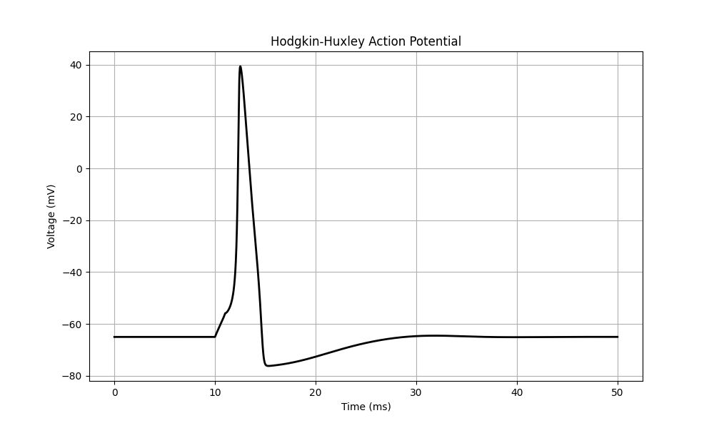
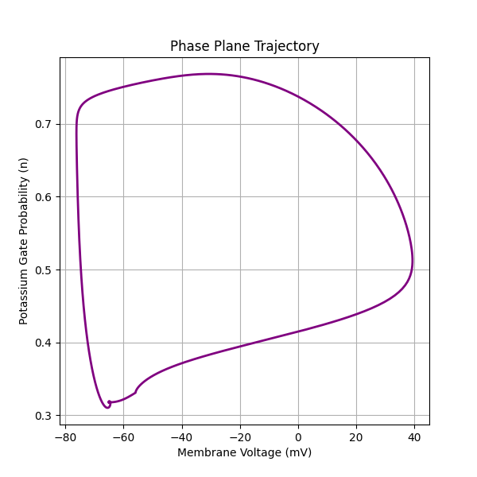
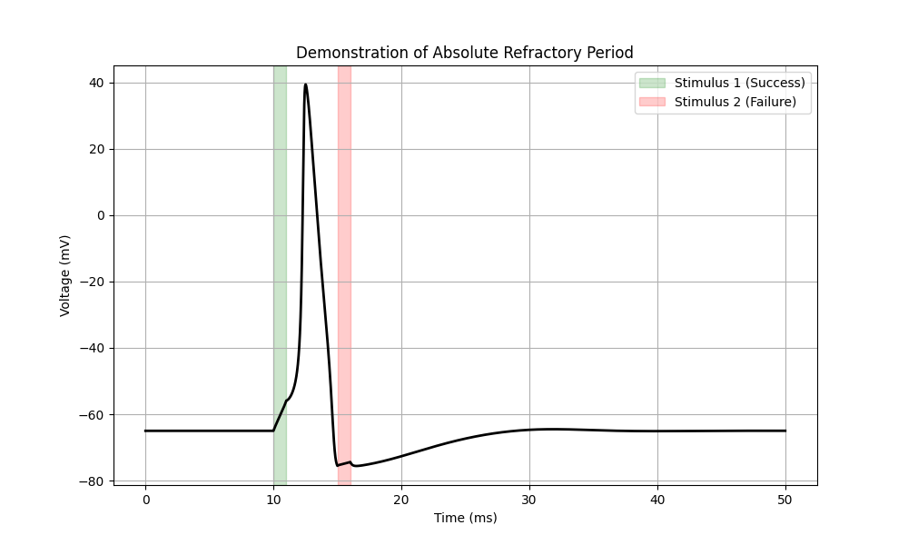

# Hodgkin-Huxley Neuron Simulation

A Python implementation of the 1952 Hodgkin-Huxley model describing action potential generation in the giant squid axon.

## Key Visualizations

### 1. Single Action Potential
The classic spike generation in response to a 10ms current injection.

### 2. Phase Plane Analysis
A trajectory plot of Membrane Voltage (V) vs Potassium Activation (n), demonstrating the limit cycle nature of the system.

### 3. Absolute Refractory Period
Demonstrating that the neuron cannot fire immediately after a spike (at 15ms) due to Sodium channel inactivation (h-gate).

## How to Run
1. Install dependencies: `pip install numpy matplotlib`
2. Run the simulation: `python simulation.py`